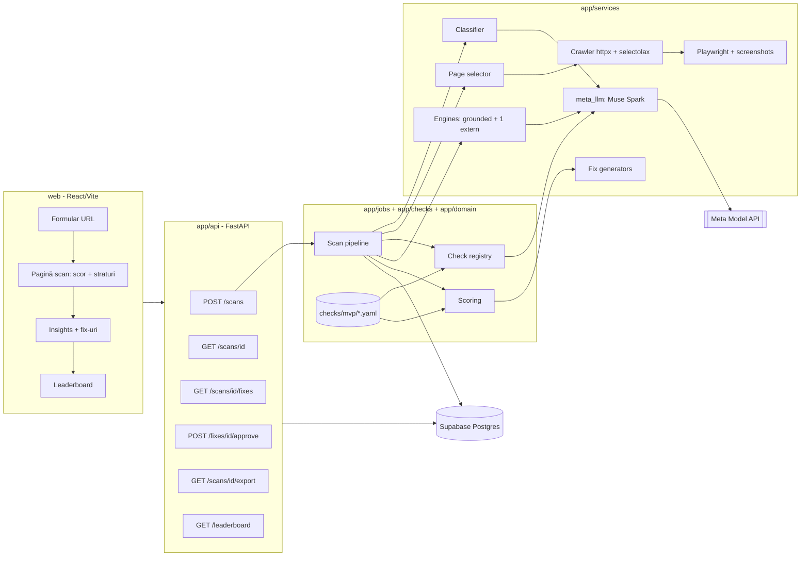
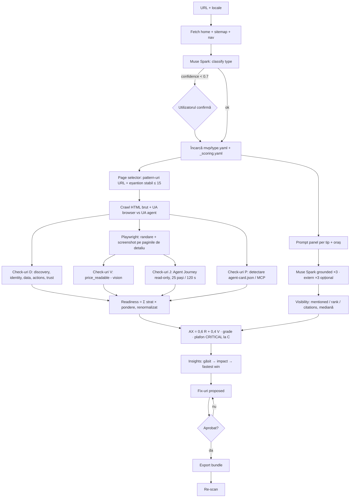
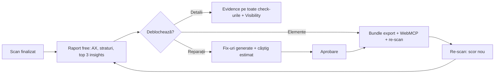

# ax-scanner — Plan MVP (hackathon META)

**Surse:** SPEC.md · docs/PLAN.md · docs/checks/mvp/*.yaml · **Deadline real:** 4 Nov 20:00 (Bucharest) · **Zile:** 27 Oct → 4 Nov

> **Stare la 2026-11-02:** documentul de mai jos este planul inițial. Ce s-a implementat, ce s-a abătut de la plan (Visibility, vision și paywall nerealizate; importator redus la 15 checkuri; fix-uri doar pentru dealeri) și ce mai lipsește sunt în `docs/GAP-ANALYSIS.md`.

## 1. Scope MVP
| În MVP | Amânat (V2) |
|---|---|
| Step 0: clasificare dealer / importer / ecommerce (Muse Spark) | Validare completă AAP 3.0 (14 check-uri) |
| 53 check-uri (dealer 19 · importer 17 · ecommerce 17) din `docs/checks/mvp/` | % dealeri din rețea cu AAP |
| Readiness pe 7 straturi, ponderi per tip, renormalizare | Validare MCP / UCP / ACP (rămâne doar detectarea) |
| Vision: preț în imagine · Agent Journey: 1–2 sarcini per tip | `ux.agent_vs_human`, `ux.blockers`, cookie wall, injection |
| Visibility: Muse Spark grounded ×3 (+1 engine extern, cu flag) | Atribuire trafic AI, publicare în CMS, import feed |
| Insights + fix-uri (JSON-LD, llms.txt, robots.txt, Agent Card) → aprobare → export | Auto-apply |
| UI: scan, scor, check-uri, insights, fix-uri, leaderboard pe 20 de site-uri | Multi-tenant RLS, autentificare |

## 2. Arhitectură (clean architecture)
| Strat | Folder | Conținut | Depinde de |
|---|---|---|---|
| Domain | `app/domain/` | `SiteType`, `Check`, `CheckResult`, `Score`, `Insight`, `Fix`; scoring pur | — |
| Config | `docs/checks/mvp/*.yaml` | ponderi, check-uri, severitate, `_scoring.yaml` | — |
| Services | `app/services/` | classifier, page_selector, crawler, renderer (Playwright), meta_llm, engines, fix_generators | domain |
| Checks | `app/checks/` | registry `id → async fn(ctx) → CheckResult` (un fișier per strat) | domain, services |
| Jobs | `app/jobs/scan.py` | pipeline-ul de scan (asyncio.gather) | checks, services, repo |
| Repo | `app/repo/` | tabele SQLModel + query-uri (Supabase Postgres) | domain |
| API | `app/api/` | routere FastAPI | jobs, repo |
| UI | `web/` | React/Vite pe Vercel | API |

**Regula de bază:** un singur motor. Un check nou înseamnă o linie în YAML și o funcție în registry, fără clase per tip.

## 3. Diagrama de componente

## 4. Flux de scan

## 5. Model de date (MVP)
| Tabel | Câmpuri cheie | Schimbare față de SPEC |
|---|---|---|
| `site` | id, tenant_id, url, type, locale | `vertical` → `type` |
| `scan` | id, site_id, status, classification jsonb, readiness, visibility, ax_score, grade, scoring_version | + status, grade, versiune |
| `check_result` | scan_id, check_id, layer, status (pass/warn/fail/na), severity, evidence jsonb | `passed bool` → status |
| `layer_score` | scan_id, layer, score, weight | nou |
| `prompt_run` | scan_id, engine, prompt, run_no, mentioned, rank, citations jsonb | legat de scan |
| `insight` | scan_id, check_id, finding, impact, fastest_win, priority | — |
| `fix` | id, scan_id, check_id, type, payload jsonb, status (proposed/approved/exported), est_gain | + est_gain |
| — | `site_type_template` → fișiere YAML | config în repo, nu în DB |

## 6. Plan pe zile
| Zi | Dată | Livrabil | Gata când |
|---|---|---|---|
| D1 | 27 Oct | Schelet FastAPI + SQLModel + Alembic, loader YAML, registry gol, smoke test Meta API (text, structured, grounding, vision) | 4 apeluri verzi; YAML-urile se încarcă |
| D2 | 28 Oct | Classifier + page selector + crawler + check-urile D pentru Discovery și Identity + scoring | 10 site-uri clasificate corect; scor reproductibil ±5 pe 3 rulări |
| D3 | 29 Oct | Check-uri D pentru Data, Actions și Trust (dealer) + Playwright + vision `inv.price_readable` | dealer: 19/19 check-uri cu evidence |
| D4 | 30 Oct | Agent Journey (`ux.j_find`, `ux.j_act`) + `proto.aap_card` + importer/ecommerce (refolosesc ~70% din funcții) | 53 check-uri rulează |
| D5 | 31 Oct | Visibility (grounded ×3, +1 extern) + insights + fix generators (JSON-LD, llms.txt, robots, Agent Card) | JSON-LD trece validatorul; panel stabil |
| D6 | 1 Nov | UI: raport free (badge tip, scor + straturi, top insights) + paywall detalii / fix-uri / elemente (flag de deblocare), approve/export, re-scan | end-to-end pe 1 site, free → deblocat |
| D7 | 2 Nov | 20 de site-uri (14 dealer, 3 importer, 3 ecommerce) + leaderboard | 20/20 scanate |
| D8 | 3 Nov | Deploy (Railway + Vercel), video 2–3 min, README „Built with Meta Model API” | trimis |
| Buffer | 4 Nov | Rezervă | trimis până la 20:00 |

## 7. Ordine de tăiere
| # | Tai | Efect |
|---|---|---|
| 1 | Engine extern | Visibility doar din Muse Spark |
| 2 | `ux.j_act` + `proto.*` | Protocol = „not adopted” static |
| 3 | Check-urile de Trust în afară de HTTPS | — |
| 4 | Ecommerce | Rămân dealer + importer |
| 5 | Leaderboard live | Înlocuit cu un tabel static |

## 8. Criterii de acceptare
| Criteriu | Test |
|---|---|
| Reproductibilitate | Același site, 3 scanări → AX ±5 (eșantion seed = hash domeniu) |
| Clasificare | ≥ 9/10 corect pe setul de test |
| Fix valid | JSON-LD trece Schema.org validator |
| Siguranță | 0 formulare trimise, 0 tool-uri de scriere, `mcp_url` doar din descoperire |
| Aprobare | Niciun export fără `approved` |
| Demo | 20 de site-uri scanate, clasate, cu insights |

## 9. Raport final + monetizare
Utilizatorul primește întotdeauna **raportul final gratuit**. Plătește pentru **detalii**, **reparații (fix-uri)** și **elemente gata de implementat**.

| Nivel | Ce primește | Acces |
|---|---|---|
| **Raport (free)** | AX Score + grade, scor pe cele 7 straturi, top 3 insights (găsit → impact), număr de check-uri fail/warn per strat, poziția în leaderboard | Gratuit, fără cont |
| **Detalii (paid)** | Toate check-urile cu evidence (pagini, snippet, ce lipsește), răspunsurile Visibility + citări, pașii Agent Journey | Deblocat per scan |
| **Reparații (paid)** | Fix-uri generate per check: JSON-LD (AutoDealer, Car, Offer), llms.txt, robots.txt, FAQ, Agent Card AAP, cu câștigul de scor estimat | Deblocat per scan sau abonament |
| **Elemente (paid)** | Bundle de export gata de lipit (per pagină / template), snippet WebMCP, re-scan de verificare după aplicare | Abonament / pachet |

**Regula de produs:** insight-ul arată *ce* și *cât costă*, iar fix-ul arată *cum*. Câștigul estimat (`est_gain`) e motivul pentru care utilizatorul plătește.

| Implementare MVP | Detaliu |
|---|---|
| Câmp `scan.access_level` | `free` / `details` / `fixes` / `full` |
| API | `GET /scans/{id}` întoarce versiunea free; `/details`, `/fixes`, `/export` verifică `access_level` (în demo e deblocat cu un flag) |
| UI | Raportul complet e vizibil; detaliile și fix-urile sunt blurate, cu CTA „Deblochează” și câștigul de scor afișat |
| Plată | **În afara hackathon-ului** (Stripe în V2). În demo arătăm paywall-ul și deblocarea |
| Export | PDF / HTML pentru raportul free (lead magnet), JSON + fișiere pentru varianta plătită |

## 10. Folosirea Meta (pentru jurați)
| Capabilitate Muse Spark | Unde |
|---|---|
| Structured output | classifier, `trust.policies_text`, insights |
| Vision | `*.price_readable` pe screenshot |
| Tool calling + browser | Agent Journey (`ux.j_*`) |
| Search grounding | Visibility (Meta AI = engine #1) |
