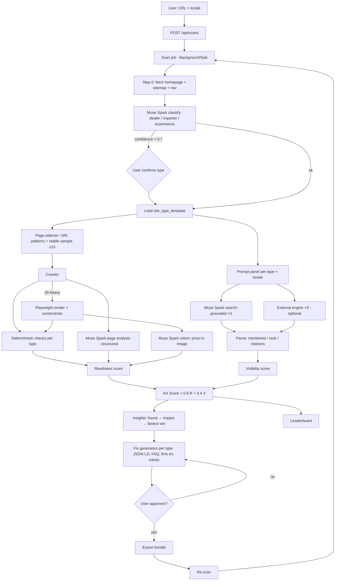

# ax-scanner — Hackathon Plan (review of SPEC.md)

Meta Global AI Developer Hackathon · Indie track
**Submission deadline: 5 Nov 2026, 06:30 IST = 03:00 Bucharest (treat 4 Nov 20:00 as the real cut)**
Judging 5–9 Nov · Finals 10 Nov · Workshops / office hours 27 Oct – 4 Nov
Available working days: **8** (27 Oct → 4 Nov).

## 1. Review verdict
| Area | SPEC today | Change |
|---|---|---|
| Meta stack use | Muse Spark only for page analysis | Muse Spark at the core: **site classification**, structured output, tool calling, **search grounding** (Meta AI = visibility engine #1), **vision** |
| Site type | Single vertical (car dealer) | **Step 0: classify** the site as dealer / importer / ecommerce. The type drives pages, fields, schema and prompts |
| "Prices in images" check | Deterministic | Muse Spark vision on screenshots. SAM 3.1 optional |
| External engines | LiteLLM × 4 × 3 runs | MVP: Muse Spark grounded + 1 external, others behind a flag |
| Backend | Django REST + Celery/Redis + RLS | **FastAPI + Pydantic + SQLModel**, async, BackgroundTasks. No RLS, `tenant_id` column kept |
| Fix approval | proposed→approved→applied | proposed → approved → **export** |
| Scoring | 0.6 readiness / 0.4 visibility | Keep. Visibility shown with a ± band |
| Demo set | 20 dealer sites | 20 pre-scanned (mostly dealers + a few importers/ecommerce) + 1 live |
| Deliverables | — | 2–3 min video, public repo, README "Built with Meta Model API" |

## 2. Stack (decided 27 Oct)
| Layer | Choice |
|---|---|
| API | FastAPI (async) + Pydantic v2 |
| ORM / migrations | SQLModel + Alembic |
| Jobs | BackgroundTasks + asyncio.gather (no Redis) |
| DB | Supabase Postgres |
| Crawler | httpx + selectolax. Playwright fallback |
| LLM | Meta Model API `muse-spark-1.3`, OpenAI-compatible SDK, base `https://api.meta.ai/v1` |
| UI | React/Vite on Vercel |
| Hosting API | Railway / Render (Docker, Playwright image) |

```
app/
  domain/      # site types, checks, scoring, insight/fix models (pure)
  services/    # classifier, crawler, page_selector, meta_llm, engines, fix_generators
  repo/        # SQLModel tables + queries
  api/         # FastAPI routers
  jobs/        # scan pipeline
  templates/   # site_type_template: dealer.yaml, importer.yaml, ecommerce.yaml
```

## 3. Step 0 — Site classification (decided 27 Oct)
Input: homepage, sitemap and main navigation (1–3 requests). Deterministic signals are extracted first, then Muse Spark returns structured output `{type, confidence, brands[], locations, evidence[]}`. If `confidence < 0.7`, the user confirms or corrects the type in the UI.

| Signal | Dealer | Importer | E-commerce |
|---|---|---|---|
| Locations | 1–5 showrooms | dealer network ("find a dealer") | few or none |
| Stock with VIN / km | yes (new + used) | rare, configurator / models | no (products / SKU) |
| Prices | per vehicle | "from X €", offers | per product + cart |
| Cart / checkout | no | no | **yes** |
| Service / booking | **yes** | redirect to dealers | no |
| Brands | 1–3 (multi-brand used) | 1 brand | many |
| Existing schema | AutoDealer, Car | Organization, Brand | Product, Offer |

Stored in `site.type` + `scan.classification` (jsonb).

## 4. Pages crawled per type (budget ~15 pages)
| Page type | Dealer | Importer | E-commerce |
|---|---|---|---|
| Homepage | 1 | 1 | 1 |
| Stock list / catalog | 2 (new, used) | 1 (model range) | 2 categories |
| Vehicle / product detail | **5** stock sample | **4** model pages | **5** product pages |
| Offers / promotions | 1 | 2 | 1 |
| Service / booking | 2 | — | — |
| Dealer locator | — | 1 | — |
| Configurator / test drive | 1 | 1 | — |
| Contact / about | 1 | 1 | 1 |
| FAQ / help | 1 | 1 | 1 |
| Shipping / returns / warranty | — | — | 2 |
| Financing / leasing | 1 | 1 | — |

**Page selection:** sitemap → URL pattern rules per type (`/stoc/`, `/masini/`, `/modele/`, `/produs/`, `/service`, `/dealeri`, …) → stable random sample (seed = domain hash, for reproducible scores). The LLM is used only when patterns are inconclusive.

## 5. Per-type template (`site_type_template`)
| Component | Dealer | Importer | E-commerce |
|---|---|---|---|
| Required schema | AutoDealer, Car/Vehicle, Offer, AutoRepair | Organization, Brand, Car (model), dealer list | Product, Offer, AggregateRating, MerchantReturnPolicy |
| Template fields | price, km, year, fuel, VIN, availability | range, "from" price, specs, dealers | price, SKU/GTIN, stock, shipping |
| Action check | test drive / service booking | find dealer / configurator | add-to-cart, checkout without blocking |
| Prompt panel | "best {brand} dealer in {city}" | "best electric SUV under 50k" | "where to buy {product} online" |

MVP depth: **dealer = full**, importer + ecommerce = base templates (shows versatility, low risk).
Replaces `vertical_template` from SPEC §8: `site_type_template(site_type pk, page_types jsonb, url_patterns jsonb, required_fields jsonb, schema jsonb, faqs jsonb, prompts jsonb)`.

## 6. Logic flow
Diagram source: `docs/diagram.mmd` · rendered: `docs/diagram.svg`, `docs/diagram.png`



## 7. Day-by-day plan
| Day | Date | Deliverable | Done when |
|---|---|---|---|
| D1 | 27 Oct | FastAPI skeleton, SQLModel tables, Meta API smoke test (text, structured, grounding, vision) | 4 green test calls |
| D2 | 28 Oct | **Classifier (step 0)** + page selector + crawler + deterministic checks + readiness | 10 sites classified correctly, 3 reproducible scores |
| D3 | 29 Oct | Muse Spark page analysis + vision price-in-image, dealer template full | evidence JSON per check |
| D4 | 30 Oct | Insights + fix generators. Importer + ecommerce base templates | JSON-LD passes validator |
| D5 | 31 Oct | Visibility: prompt panel per type, grounded ×3, +1 external | stable across 3 runs |
| D6 | 1 Nov | React UI: type badge/confirm, score, checks, insights, fixes, export | end-to-end on 1 site |
| D7 | 2 Nov | Scan 20 sites (≈14 dealers, 3 importers, 3 ecommerce), leaderboard | 20/20 scanned |
| D8 | 3 Nov | Deploy, video, README, submit | submitted by 4 Nov 20:00 |
| Buffer | 4 Nov | Slack | — |

## 8. Cut order if late
1. External engine  2. SAM 3.1  3. Ecommerce template (keep dealer + importer)  4. Leaderboard → static table  5. ES locale

## 9. Demo story (2–3 min)
1. "AI agents now shop for cars. Can they read your site?"
2. Paste URL → auto-detected "Dealer · Porsche · 2 locations"
3. AX Score 38 → insight: prices in images on 42/50 pages
4. JSON-LD fix → re-scan
5. Leaderboard: dealers vs importers vs ecommerce
6. "Built on Muse Spark: classification, structured output, vision, search grounding"

## 10. Open questions
- Official judging criteria and submission format
- Meta API rate limits / credits
- Public deploy required or video + repo enough?
- Mixed sites (dealer that also sells parts online): one primary type + secondary flags?
